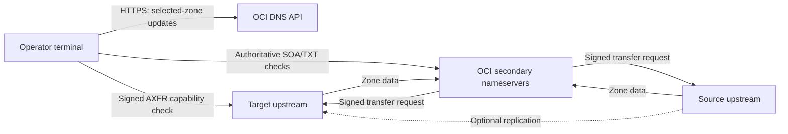

# Architecture and scope

## Components and responsibilities

| Component | Role | Caller-defined inputs |
| --- | --- | --- |
| Source upstream | Existing DNS server serving selected zones with TSIG | Source IPv4/IPv6 address and record-management process |
| Target upstream | Replacement DNS server with synchronized records and matching per-zone TSIG material | Target IPv4/IPv6 address and transfer ACLs |
| OCI public secondary DNS | Pulls zone contents from configured upstreams and answers authoritative queries | Compartment, zone OCIDs and DNS management region |
| Operator | Runs export, preview/apply and verification scripts | Mac, Linux or Windows machine; OCI API-key profile |

Servers can be deployed in OCI, another cloud, an external DNS provider or a data centre. Their locations, operating systems and replication design are external to the migration scripts. The management region selects the OCI API endpoint; the public authoritative service is global.

The source and target must serve consistent data during overlap. Removing the source from OCI does not promote the target into an independent record source. If the target still replicates from the source, migrate that dependency separately before retiring the source.

## Secondary DNS and hidden primaries

The upstream controls zone records and SOA serials. OCI's secondary zone copies transferred records and answers authoritative queries. With a hidden primary, public delegation points at the secondary nameservers and excludes the upstream. The migration scripts update upstream addresses; they do not change delegation or edit upstream records. [Oracle secondary DNS overview](https://docs.oracle.com/en-us/iaas/Content/DNS/Tasks/secondary-dns.htm).

Use zone names you administer and explicitly select their OCIDs. Direct verification queries assigned OCI nameservers, so it checks authoritative contents independently of recursive caches. Validate delegation separately when required. Public secondary DNS is a public resource; record visibility follows that service's model.

## Network flows

| From | To | Protocol and purpose |
| --- | --- | --- |
| Operator | OCI API | HTTPS 443, authenticated SDK calls |
| Operator | Target upstream | TCP 53, signed AXFR capability check |
| Operator | OCI assigned nameservers | UDP/TCP 53, authoritative SOA/TXT queries |
| OCI transfer destination servers | Configured upstreams | TCP 53 AXFR/IXFR and DNS refresh checks |
| Configured upstreams | OCI transfer destination servers | Signed NOTIFY on UDP 53 |
| Source and target | Each other, if replication is used | DNS transfer/notification traffic according to the chosen design |
| Administrator | Upstream servers, optionally | Administration and collection of transfer telemetry |

Discover current receiving OCI transfer-server IPs in the selected DNS management region using the root tenancy OCID and `is-transfer-destination=true`. Refresh that list for your deployment. [Oracle transfer-server discovery](https://docs.oracle.com/en-us/iaas/Content/DNS/Tasks/zone-transfer-server-list.htm).

TSIG authentication and network access are separate requirements. The operator's direct signed AXFR requires its outbound address to be permitted by target network and host-firewall rules. TSIG authenticates messages; it does not encrypt transferred zone contents. Keep server-specific ACL configuration under your DNS administration process.
